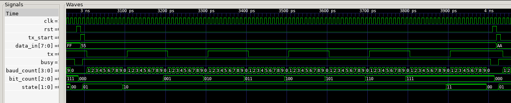

# UART Transmitter — SystemVerilog

A configurable 8-bit UART (Universal Asynchronous Receiver/Transmitter) transmitter designed in SystemVerilog and verified using Verilator and a C++ testbench.

This project was developed independently to build practical experience in RTL design, finite-state machines, digital timing and hardware verification.

## Overview

The transmitter implements the UART 8N1 serial communication format:

- 1 start bit (LOW)
- 8 data bits (least significant bit first)
- No parity bit
- 1 stop bit (HIGH)

The transmission line remains HIGH when idle.

## Architecture

The design consists of:

- **Finite-State Machine (FSM):** Controls four states — IDLE, START, DATA and STOP.
- **8-bit Data Register:** Stores the byte being transmitted.
- **Bit Counter:** Tracks which of the eight data bits is currently being sent.
- **Baud-Rate Counter:** Controls the duration of each transmitted bit.
- **Status Signal:** The `busy` output indicates when a transmission is in progress.

The baud counter's width is automatically calculated based on the configured clock frequency and baud rate.

## Tools and Technologies

- SystemVerilog — RTL hardware implementation
- C++ — Simulation testbench
- Verilator — RTL compilation, simulation and linting
- GTKWave — Waveform visualisation and analysis
- Git/GitHub — Version control

## Project Structure

- `rtl/uart_tx.sv` — UART transmitter RTL
- `tb/uart_tx_tb.cpp` — C++ verification testbench
- `docs/uart_waveform.png` — Captured UART timing waveform
- `README.md` — Project documentation

## Simulation

The default configuration uses a 1 MHz clock and a 100,000-bit/s baud rate, giving 10 clock cycles per transmitted bit.

Run the following commands from the project root.

**1. Check the RTL for warnings and errors:**

`verilator --lint-only -Wall -Wno-fatal --top-module uart_tx rtl/uart_tx.sv`

**2. Build the simulator with waveform tracing:**

`verilator --cc --exe --build --trace --top-module uart_tx rtl/uart_tx.sv tb/uart_tx_tb.cpp`

**3. Execute the testbench:**

`./obj_dir/Vuart_tx`

**4. Inspect the waveform:**

`gtkwave uart_waveform.vcd`

## Verification

A C++ testbench automatically verifies complete UART frames, checking start and stop bits, data-bit ordering, bit timing and the `busy` signal.

Test patterns include:

| Input | Purpose |
|---|---|
| `0x00` | All-zero data |
| `0xFF` | All-one data |
| `0x55` | Alternating bits |
| `0xAA` | Inverse alternating bits |
| `0x41` | ASCII character 'A' |

Additional tests verify:

- Consecutive transmissions without an intervening reset
- Synchronous reset during active transmission
- Recovery and successful transmission after reset

All implemented tests passed in Verilator simulation.

## Waveform Analysis

GTKWave was used to inspect the transmitter's serial output, state transitions, baud counter, bit counter and busy signal.

The captured waveform illustrates UART transmission of `0x55`, including the start bit, eight alternating data bits and stop bit.

## Limitations and Future Improvements

This first version implements the transmitter only, with no receiver or physical FPGA deployment.

The baud-rate counter uses integer division, so some clock-frequency and baud-rate combinations may introduce timing error. Future improvements could include additional parameter validation, a UART receiver, FIFO buffering and FPGA implementation.
